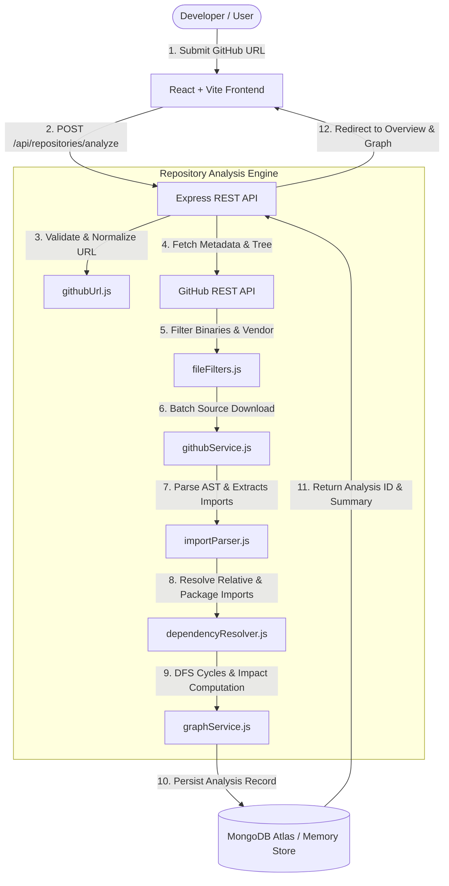

# RepoRadar 📡
> **Turn any GitHub repository into an interactive map of its codebase.**

## 🎯 Problem Statement
When developers onboard onto unfamiliar open-source projects or legacy enterprise codebases, understanding the architectural flow takes days of tedious manual inspection. Flat file trees and simple text search fail to answer critical software engineering questions:
- What does this codebase actually contain and which files are heavily coupled?
- Which files are imported most frequently across the project?
- What is the blast radius (ripple effect) if a specific core file is refactored?
- Are there hidden circular dependency loops that could cause bundling or runtime initialization bugs?

## 👥 Target Users
- **Software Engineers & Developers**: Rapidly understand unfamiliar open-source or team repositories before contributing.
- **Software Architects & Tech Leads**: Inspect structural coupling, audit code modularity, and detect circular dependencies.
- **Code Reviewers & QA Engineers**: Assess the blast radius of changes to prevent unexpected regressions.
- **Students & Learners**: Visually explore real-world production codebases and study modern design patterns.

## 💡 Proposed Solution
RepoRadar transforms any public GitHub repository into an interactive, multi-dimensional codebase map. By fetching the bounded source tree and parsing files with Babel's Abstract Syntax Tree (AST) engine, RepoRadar extracts actual internal import/export relationships, isolates external npm packages, detects directed cycles, and computes transitive blast radius metrics through a responsive, multi-page dark developer workspace.

---

## 🌟 Key Features

- **Genuine AST Import Analysis**: Uses `@babel/parser` and `@babel/traverse` to parse ECMAScript (ESM), CommonJS (`require`), dynamic `import()`, TypeScript, and JSX syntax into verified dependency relationships. No mock graphs or fabricated data.
- **Interactive Directed Graph**: Built with React Flow (`@xyflow/react`), offering pan, zoom, minimap, node search, directory filtering, and interactive node selection with dependency highlight states.
- **Directed Edge Convention**: Clearly documented convention: `File A ➔ File B` means **File A imports File B** (File A depends on File B).
- **Blast Radius & Impact Analysis**: Select any file to compute its immediate callers, direct dependencies, and transitive dependents across the entire repository.
- **Cycle & Anomaly Detection**: Depth-first search (DFS) with recursion stack identifies circular dependencies (`A ➔ B ➔ A`), isolated entry points, and unresolved path aliases.
- **Three-Panel Code Explorer**: Browse hierarchical file trees, view syntax-highlighted source code with line numbers, and inspect incoming/outgoing dependencies with one-click navigation.
- **Instant Guest / Demo Access**: 1-click test-drive mode granting full platform access without sign-up or email credentials.
- **Dead Code & Orphan File Hunter**: Detects unreferenced internal files with 0 incoming imports (excluding entrypoints, configs, tests, routes), calculates wasted LOC and bundle bloat, and provides one-click cleanup checklists.
- **Interactive 3D Code City**: Visualizes repository architecture as an interactive 3D procedural skyline where building heights map to file LOC and colors represent coupling and complexity.
- **Neon Circuit: Live Request & Data-Flow Tracer**: Simulates real-time in-flight HTTP request propagation across the concrete AST dependency topology. Features a PCB motherboard design with glowing chip pins, live payload telemetry inspection, audio frequency synthesis, and step-by-step playback controls.
- **Production-Ready Architecture**: Centralized error handling, input validation with SSRF protection, rate limiting, and responsive dark developer theme.

---

## 🏗️ Architecture & Data Flow



---

## 📁 Project Structure

RepoRadar adheres to a clean, modular MERN architecture with dedicated `backend/` and `frontend/` workspaces:

```text
reporadar/
├── backend/            # Express REST API, MongoDB models, auth & controllers
├── frontend/           # React + Vite client app, Tailwind CSS design system
├── README.md           # Complete documentation, API guides, and architecture
├── .gitignore          # Git exclusion rules
└── package.json        # Root scripts to orchestrate backend & frontend

⚙️ Backend Structure (backend/)
backend/
├── index.js                     # Express app entry point, middleware registration & route mounting
├── .env.example                 # Environment variable template (PORT, MONGO_URI, JWT_SECRET, etc.)
├── seed.js                      # Standalone CLI script to seed MongoDB with initial popular repositories
├── package.json                 # Node package dependencies and script definitions
├── tests/                       # Automated unit and API integration test suite (35 passing tests)
└── src/
    ├── config/
    │   └── database.js          # MongoDB connection with automated in-memory MongoDB fallback
    ├── controllers/
    │   ├── auth.controller.js       # User registration, login, profile fetching (JWT)
    │   └── repository.controller.js # Repository scanning, graph generation, file content, impact
    ├── models/
    │   ├── user.model.js            # User schema (name, email, salted bcrypt password)
    │   └── repository.model.js      # Repository analysis schema & resilient memory fallback store
    ├── routes/
    │   ├── auth.routes.js           # /api/auth endpoints (/register, /login, /me)
    │   ├── repository.routes.js     # /api/repositories endpoints (/analyze, :id, graph, impact)
    │   └── health.routes.js         # /api/health endpoint
    ├── middlewares/
    │   ├── auth.middleware.js       # Verifies JWT Bearer tokens and attaches user to req.user
    │   ├── rateLimiter.middleware.js # Express rate limiting for API protection
    │   └── error.middleware.js      # Centralized error handler and JSON formatter
    ├── services/
    │   ├── githubService.js         # GitHub REST API tree fetching & file streaming
    │   ├── importParser.js          # Babel AST parser for ESM, CJS, dynamic imports & TS
    │   ├── dependencyResolver.js    # Module path resolver & external package classifier
    │   └── graphService.js          # Directed graph builder, cycle detector & impact calculator
    └── utils/
        ├── db.js                    # MongoDB / Memory fallback connection helper
        ├── generateToken.js         # Signs JWTs with configurable expiration
        ├── githubUrl.js             # GitHub URL parser, validator & SSRF filter
        └── fileFilters.js           # Excludes binaries, lockfiles, minified bundles, vendor

🎨 Frontend Structure (frontend/)
frontend/
├── index.html                   # HTML document root and Google Fonts preconnect
├── vite.config.js               # Vite configuration and dev server proxy
├── package.json                 # Frontend dependencies (React 19, Lucide icons, React Flow, Recharts)
├── vercel.json                  # Single Page Application (SPA) rewrite fallback configuration
└── src/
    ├── main.jsx                 # React root initialization with AuthProvider and Router
    ├── App.jsx                  # Top-level route declarations, navigation layout, and route guards
    ├── index.css                # Core design system tokens, glassmorphism styling, and animations
    ├── context/
    │   └── AuthContext.jsx      # Global auth state (logged-in user, login, register, logout)
    ├── services/
    │   ├── api.js               # Centralized API client with JWT attachment & error interceptors
    │   └── repositoryService.js # Repository scanning, graph fetching, and file APIs
    ├── components/
    │   ├── Navbar.jsx           # Responsive frosted glass navigation bar with auth badges
    │   ├── ProtectedRoute.jsx   # Route guard requiring authenticated users
    │   ├── PublicOnlyRoute.jsx  # Redirects authenticated users away from login/register pages
    │   ├── SearchBar.jsx        # Search input with debounce & scan trigger
    │   ├── common/              # Button, Modal, Input, Skeleton, ErrorState, EmptyState
    │   ├── explorer/            # FileTree, SourceViewer, FileDetailsPanel
    │   ├── graph/               # CustomNode, DependencyGraph, GraphControls, GraphLegend
    │   └── layout/              # RepositoryLayout, PublicNavbar
    └── pages/
        ├── Home.jsx             # Hero landing section with features & quick scan
        ├── Dashboard.jsx        # Platform statistics and repository catalog
        ├── RepositoryOverview.jsx # Repository health, language metrics & notices
        ├── CodeExplorer.jsx     # Three-panel AST code explorer with syntax highlighting
        ├── DependencyGraph.jsx  # Interactive React Flow directed graph
        ├── DependencyAnalysis.jsx # Cycles, top imported files, blast radius calculator
        ├── History.jsx          # Historical repository analysis timeline
        ├── Settings.jsx         # User profile, tokens, and storage preferences
        ├── Login.jsx            # User sign in page
        ├── Register.jsx         # User registration page
        └── NotFound.jsx         # 404 fallback page
```

---

## 🛠️ Technology Stack

| Layer | Technologies |
|---|---|
| **Frontend** | React 19, Vite, React Router v7, Tailwind CSS, Lucide React, `@xyflow/react` (React Flow), Recharts |
| **Backend** | Node.js (v24), Express.js, `@babel/parser`, `@babel/traverse`, Axios, Helmet, Morgan, Express Rate Limit |
| **Database** | MongoDB Atlas, Mongoose schemas with indexing (and resilient in-memory fallback) |
| **Testing** | Node.js Native Test Runner (`node:test`, `node:assert`), 28 unit and API integration tests |
| **Deployment** | Vercel (Frontend with SPA rewrite rules), Render (Backend Express server) |

---

## 📡 API Documentation

Base URL: `http://localhost:5000/api`

### 1. Health Check
- **`GET /api/health`**
- Returns server uptime, operational status, and database connection mode (`mongodb-connected` or `in-memory-fallback`).

### 2. Analyze Repository
- **`POST /api/repositories/analyze`**
- **Body**: `{ "url": "https://github.com/owner/repository" }`
- **Response**:
```json
{
  "success": true,
  "message": "Repository successfully analyzed and persisted.",
  "id": "repo_1792917447846_psg7se",
  "metadata": {
    "owner": "expressjs",
    "name": "express",
    "stars": 69577,
    "defaultBranch": "master",
    "primaryLanguage": "JavaScript"
  },
  "summary": {
    "totalRepoFiles": 284,
    "supportedSourceFiles": 140,
    "analyzedFilesCount": 140,
    "internalEdgesCount": 74,
    "externalPackagesCount": 54,
    "cycleCount": 0
  }
}
```

### 3. List Persisted Repositories
- **`GET /api/repositories?search=`**
- Returns all analyzed repositories with platform-wide summary statistics (total repos, total source files analyzed, total dependencies discovered).

### 4. Repository Overview Details
- **`GET /api/repositories/:id`**
- Returns repository metadata, language breakdown percentages, directory summaries, and analysis notices.

### 5. File Tree & Source Code
- **`GET /api/repositories/:id/files`**: Returns the list of analyzed files and full repository tree.
- **`GET /api/repositories/:id/files/content?path=lib/express.js`**: Returns cached source code of the requested file path.

### 6. Dependency Graph
- **`GET /api/repositories/:id/graph`**
- Returns graph nodes and directed edges with in-degrees, out-degrees, and labels.

### 7. Deep Dependency Analysis & Metrics
- **`GET /api/repositories/:id/analysis`**
- Returns most-imported files, most-dependent files, circular dependency chains, and disconnected files.

### 8. Blast Radius Impact Analysis
- **`GET /api/repositories/:id/impact?file=lib/express.js`**
- Calculates direct dependencies, direct callers, and transitive dependents for the selected file.

### 9. Reanalyze & Delete
- **`POST /api/repositories/:id/reanalyze`**: Re-executes repository analysis and updates stored record.
- **`DELETE /api/repositories/:id`**: Deletes RepoRadar's stored analysis record without modifying the GitHub repository.

---

## 🗄️ Database Schema Overview

```javascript
RepositoryAnalysisSchema:
├── owner: String (indexed)
├── name: String (indexed)
├── fullPath: String (unique, indexed: owner/name)
├── url: String
├── defaultBranch: String
├── description: String
├── primaryLanguage: String
├── stars: Number
├── forks: Number
├── size: Number
├── status: 'completed' | 'failed'
├── analyzedAt: Date (indexed)
├── summary: { totalRepoFiles, supportedSourceFiles, analyzedFilesCount, internalEdgesCount, externalPackagesCount, cycleCount }
├── languages: [{ name, count, percentage }]
├── files: [{ path, language, size, lines, inDegree, outDegree, imports, externalImports, importedBy }]
├── fileContents: Map<String, String> (source code for Code Explorer)
├── nodes: [{ id, label, path, language, size, lines, inDegree, outDegree }]
├── edges: [{ id, source, target, type, importType, line }]
├── cycles: [[String]] (detected cycle paths)
└── directorySummary: [{ directory, fileCount, languages, internalDependencies }]
```

---

## 🚀 Local Installation & Quickstart

### Prerequisites
- Node.js v18+ (tested on Node.js v24.13.0)
- npm v9+

### 1. Clone the repository
```bash
git clone https://github.com/your-username/RepoRadar.git
cd RepoRadar
```

### 2. Install all dependencies
```bash
npm run install:all
```
*(Or install in root, backend, and frontend directories: `npm install && cd backend && npm install && cd ../frontend && npm install`)*

### 3. Configure environment variables
Copy `.env.example` to `backend/.env` and `frontend/.env`:
```bash
# Backend configuration (backend/.env)
PORT=5000
MONGODB_URI=mongodb://localhost:27017/reporadar
GITHUB_TOKEN=   # Optional: higher rate limits for public GitHub API
CLIENT_URL=http://localhost:5173

# Frontend configuration (frontend/.env)
VITE_API_BASE_URL=http://localhost:5000/api
```
*(Note: If no local or remote MongoDB instance is running, RepoRadar automatically activates its resilient in-memory storage fallback with zero configuration required!)*

### 4. Run tests
```bash
npm test
```
Runs 28 automated unit and integration tests verifying URL parsing, AST imports, module resolution, cycle detection, and REST APIs.

### 5. Start the development servers
```bash
npm run dev
```
Launches both the Express API server on `http://localhost:5000` and the Vite React frontend on `http://localhost:5173`.

---

## 🌐 Deployment Instructions

### Frontend (Vercel)
1. Push repository to GitHub.
2. Import the `frontend/` folder into Vercel.
3. Set Environment Variable: `VITE_API_BASE_URL=https://your-backend.onrender.com/api`.
4. Build Command: `npm run build` (Output Directory: `dist`).
5. Notice: `frontend/vercel.json` and `frontend/public/_redirects` are already configured for client-side React Router rewrites.

### Backend (Render)
1. Create a new Web Service on Render pointing to the `backend/` root.
2. Build Command: `npm install`.
3. Start Command: `node src/server.js`.
4. Environment Variables:
   - `PORT=5000`
   - `MONGODB_URI=mongodb+srv://<username>:<password>@cluster.mongodb.net/reporadar?retryWrites=true&w=majority`
   - `CLIENT_URL=https://your-frontend.vercel.app`
   - `NODE_ENV=production`

---

## ⚠️ Current Scope & Limitations

- **Language Scope**: Currently analyzes **JavaScript** (ESM, CommonJS, JSX) and **TypeScript** (TS, TSX). Non-JS/TS files (Markdown, JSON, HTML, Python, Go) are classified in the directory tree but not parsed for internal imports.
- **Dynamic Imports**: Statically detectable `import('...')` string literals and CommonJS `require('...')` calls are mapped. Computed runtime expressions (e.g. `require('./plugins/' + name)`) cannot be statically resolved.
- **Repository Bounds**: To ensure responsive browser performance and respect GitHub API quotas, single repository analysis is bounded to 150 source files and files under 250 KB.
- **Path Aliases**: Standard `@/...` and `~/...` aliases mapping to `src/` or root are resolved. Highly customized `tsconfig.json` paths or dynamic webpack plugins are reported in unresolved imports.

---

## 📋 End-Term Project Submission Details

Use the following information when completing the [Official Submission Form](https://forms.gle/sBy4sfqyiRG2Zpom9):

```text
Project Name: RepoRadar

Student Name: [Your Name]

Problem Statement: Understanding unfamiliar, complex open-source or company codebases requires days of tedious manual inspection. Flat file trees and text search cannot reveal architectural coupling, high-frequency dependencies, transitive blast radius impact, or hidden circular dependency loops.

GitHub Repository: [Your GitHub Repository URL]

Deployed Application / Build: [Your Deployed Vercel URL]

Demo Video: [Link to 3-5 minute demo video on YouTube / Google Drive / Loom]

Tech Stack: React 19, Vite, React Router, Tailwind CSS, React Flow (@xyflow/react), Node.js, Express.js, Babel AST Parser (@babel/parser, @babel/traverse), MongoDB Atlas, Mongoose, JWT, bcryptjs

Major Features:
1. Real AST Source Import Analysis (ESM, CJS, TypeScript, JSX)
2. Interactive Directed Codebase Graph with Hierarchical Layering
3. Transitive Blast Radius Impact Analysis (ripple effect calculator)
4. DFS Directed Cycle Detection & Disconnected File Auditor
5. Three-Panel Code Explorer with Syntax Highlighting and AST Inspector
6. JWT User Authentication & Platform Analytics Dashboard
```

---

## 🎬 3 to 5 Minute Demo Presentation Script

For recording your demonstration video:

- **Segment 1 (0:00 – 0:40) Introduction & Problem**: Open `http://localhost:5173/`, introduce RepoRadar, explain challenges with understanding large unfamiliar codebases.
- **Segment 2 (0:40 – 1:20) Analysis Pipeline**: Enter `https://github.com/expressjs/express`, click Scan, explain AST parsing, filtering, and cycle detection.
- **Segment 3 (1:20 – 2:00) Overview & Health**: Walk through analyzed files (140), internal edges (74), external packages (54), and directory statistics.
- **Segment 4 (2:00 – 2:45) Three-Panel Code Explorer**: Select `lib/express.js`, show syntax highlighting, line numbers, and click-to-navigate dependencies.
- **Segment 5 (2:45 – 3:30) Interactive Directed Graph**: Explore React Flow canvas, node selection, edge arrows (`A -> B` means `A` imports `B`), and mini-map.
- **Segment 6 (3:30 – 4:10) Blast Radius & Metrics**: Demonstrate ripple-effect calculator on `lib/express.js` (26 affected files), cycles, and ranking tables.
- **Segment 7 (4:10 – 4:45) Auth, Tests & Persistence**: Show Login/Register, Dashboard saved repositories, and 35 passing automated tests.

---

## 📄 License
MIT License. Built as an open-source developer productivity tool.

